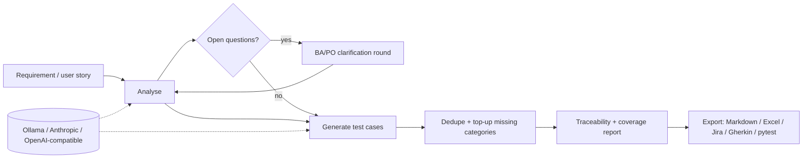

# QA Copilot

[](https://github.com/kratantjain/qa-copilot/actions/workflows/ci.yml)


An AI copilot for Quality Engineers: analyse requirements, close gaps with BA/PO, generate
traceable test cases, and export them straight into your tooling - using a **local LLM or a cloud one**.

Built by **Kratant** - 7 years across QA automation, CI/CD orchestration and internal platform tooling.

## Features

- **Requirement analysis:** gaps, ambiguities, conflicts, dependencies, acceptance criteria, risk register (likelihood x impact) and a deterministic readiness score.
- **BA/PO clarification rounds:** consolidated questions, resolved vs remaining tracking, history of every round.
- **Test design:** Positive, Negative, Boundary, Edge, Regression, Security, Performance and Accessibility; configurable mix per run; de-duplication.
- **Traceability:** every test case linked to acceptance criteria / findings, with a coverage report and uncovered-item list.
- **Multi-provider LLMs:** Ollama (local), Anthropic, any OpenAI-compatible server, plus an offline mock for tests and demos.
- **Exports:** Markdown report, CSV, Excel (4 sheets), Gherkin `.feature`, pytest skeleton, Jira/Xray CSV, JSON.
- **Interfaces:** NiceGUI web UI and a CLI for CI pipelines. SQLite run history.
- **Quality:** 44 tests, ruff, GitHub Actions CI, Dockerfile.

## How it works



Small local models are the target as much as large cloud ones, so the engine is defensive:
output is repaired and retried once, placeholder text and near-duplicate cases are dropped,
short categories get a top-up pass, and scores such as readiness and automatable/manual are
computed in code rather than trusted from the model.

## Example output

A real report generated by a 1.5B-parameter local model, fully offline:
[docs/sample_report.md](docs/sample_report.md).

## Quick start

```bash
git clone https://github.com/kratantjain/qa-copilot.git && cd qa-copilot
python -m venv .venv && source .venv/bin/activate
pip install -e ".[ui,dev]"

# Local model (default)
ollama pull qwen2.5:3b
qa-copilot ui                      # http://localhost:8080

# Or a cloud model
export ANTHROPIC_API_KEY=...       # or OPENAI_API_KEY
QA_COPILOT_PROVIDER=anthropic qa-copilot ui

# Try it with no LLM at all
QA_COPILOT_PROVIDER=mock qa-copilot ui
```

## CLI

```bash
# Full pipeline -> report + spreadsheet + automation scaffolding
qa-copilot run --story-file story.txt --domain "Payments / Fintech" \
    --format md,xlsx,feature,pytest,jira --out out/

# Custom test mix
qa-copilot generate --story "..." --spec "Positive=3,Negative=3,Security=2,Accessibility=1"

# Pipe from stdin (handy in Jenkins / GitHub Actions)
cat story.txt | qa-copilot analyze --provider ollama --format json
```

## Workflow

1. **Analyse** - summary, gaps/ambiguities/conflicts, dependencies, risks, acceptance criteria, readiness score.
2. **Clarify** - send all questions to the BA/PO at once, paste one consolidated answer; the copilot marks
   resolved vs remaining items and merges confirmed answers into the story. Every round is kept.
3. **Generate** - test cases per category, traced to acceptance criteria.
4. **Review** - coverage chips, traceability matrix, uncovered items.
5. **Export** - drop into Excel, Jira/Xray, Cucumber or pytest.

## Configuration

Environment variables (see `.env.example`): `QA_COPILOT_PROVIDER`, `QA_COPILOT_MODEL`, `OLLAMA_URL`,
`ANTHROPIC_API_KEY`, `OPENAI_API_KEY`, `OPENAI_BASE_URL`, `QA_COPILOT_TIMEOUT`, `QA_COPILOT_DB`, `QA_COPILOT_NUM_CTX` (Ollama context window, default 4096),
`QA_COPILOT_OLLAMA_SCHEMA=1` (opt in to schema-constrained output; slower on weak hardware).

### Tips for small local models

- Ollama's JSON mode keeps output valid JSON. Full schema-constrained output is available with
  `QA_COPILOT_OLLAMA_SCHEMA=1` but measured ~1.7x slower on a phone-class CPU, so it is off by default
  (it falls back to plain JSON automatically if your Ollama build rejects schemas).
- The model stays loaded between calls (`keep_alive`), prompts are compact and replies are capped.
- The default mix is 12 cases in two calls. Raise it per category in the UI or with `--spec`.
- Requirements over ~6000 characters are rejected for local models; test one feature at a time.

## Docker

```bash
docker build -t qa-copilot .
docker run -p 8080:8080 -e OLLAMA_URL=http://host.docker.internal:11434 qa-copilot
```

## Development

```bash
pytest -q          # uses the offline mock provider - no LLM needed
ruff check src tests
```

Add a provider by subclassing `Provider` (one `complete()` method) and registering it in
`providers/__init__.py`. Add an export format in `exporters/formats.py`.

## Privacy

With the `ollama` provider, requirement text never leaves your machine. With cloud providers it is sent
to that vendor - don't submit confidential or personal data unless approved. Exports neutralise
spreadsheet formula injection from model output.

## Roadmap

- Self-review pass that removes findings and test cases contradicting the requirement
- GitHub Action to run on a story file in a pull request
- Agent / MCP mode

## Limitations

- Output quality depends on the model; small local models need clearer input.
- Generated tests are suggestions and must be reviewed by a QA professional.
- Pytest/Gherkin output is a scaffold (steps are TODOs), not runnable automation.

## License

MIT - see [LICENSE](LICENSE).
